<div align="center">

# ALL'ts — All Sports Scheduler

**여러 종목, 여러 리그에 흩어진 "내 팀"의 경기 일정과 하이라이트를 한 앱에서**

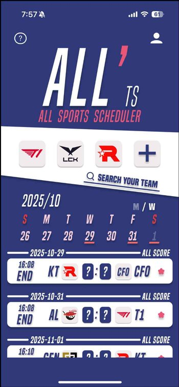&nbsp;&nbsp;
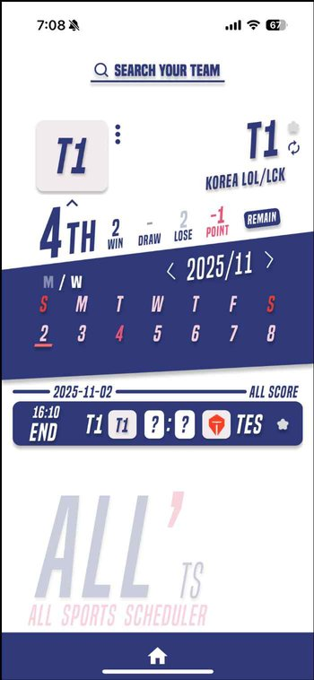&nbsp;&nbsp;
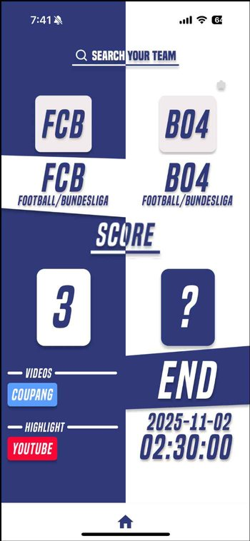


`1인 개발` · `iOS App Store 출시` · `한국외국어대학교 컴퓨터공학부 졸업 프로젝트 (2026.02)`

</div>

---

## 목차

1. [프로젝트 소개](#1-프로젝트-소개)
2. [시스템 아키텍처](#2-시스템-아키텍처)
3. [핵심 구현](#3-핵심-구현)
4. [데이터베이스 설계](#4-데이터베이스-설계)
5. [주요 화면](#5-주요-화면)
6. [트러블슈팅 & 설계 결정](#6-트러블슈팅--설계-결정)
7. [한계와 향후 계획](#7-한계와-향후-계획)

---

## 1. 프로젝트 소개

### 문제

스포츠 시청 수요는 크지만 정보는 파편화되어 있습니다.

- KBO는 2024년 1,000만 관중을 돌파했고, LCK 최고 인기 경기는 157만 명이 시청했습니다.
- 그러나 **중계·하이라이트는 종목마다, 같은 종목도 리그마다 다른 OTT**에서 제공됩니다.
- 경기 일정은 포털에 종속되어 있고, **팀이 아닌 리그 단위**로 제공됩니다.

결과적으로 여러 종목의 팀을 응원하는 사용자는 일정과 영상 링크를 **직접 찾아 모아야** 하고, 한 팀만 보고 싶은 사용자는 리그 전체 정보를 떠안게 됩니다.

### 해결

**ALL'ts**는 축구·야구·e스포츠를 아우르는 **팀 중심 통합 스케줄러**입니다.

| 기능 | 설명 |
|---|---|
| 🗓 통합 스케줄링 | 종목과 리그에 상관없이 선호 팀의 경기를 하나의 달력(월/주간)에 모아 표시 |
| 🔔 푸시 알림 | 스케줄링한 경기의 **시작**과 **하이라이트 업로드**를 FCM으로 알림 |
| 🎬 영상 연결 | YouTube·OTT에 흩어진 하이라이트/다시보기를 **AI로 분류**해 경기에 연결 |
| 📊 순위·스코어 | 팀/리그 순위, 실시간 경기 상태(END·LIVE·NEXT)와 스코어 |
| 🎨 아이콘 커스터마이징 | 팀·리그 아이콘을 사용자 이미지로 교체 |

### 담당

기획, 설계, 프론트엔드, 백엔드, 데이터 수집·AI 파이프라인, 배포와 App Store 출시까지 **전 과정을 혼자 진행**했습니다.

---

## 2. 시스템 아키텍처

세 계층이 **REST API**와 **Firebase Cloud Messaging(FCM)** 으로 통신하는 분산 구조입니다.
비용이 큰 LLM 추론은 로컬 GPU 서버에 두고, 상시 응답이 필요한 API 서버는 클라우드에 두는 방식으로 역할을 나눴습니다.

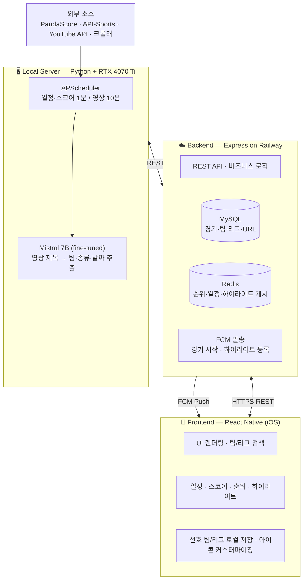

| 계층 | 기술 | 역할 |
|---|---|---|
| Frontend | React Native | iOS 앱, Google/Apple 소셜 로그인, FCM 수신 |
| Backend | Express(TypeScript), MySQL, Redis, Firebase | REST API, 데이터 관리·캐싱, 푸시 발송, GitHub 연동 CI/CD (Railway) |
| Local / AI | Python, APScheduler, Mistral 7B | 외부 데이터 수집·전처리, 영상 메타데이터 추론 |

---

## 3. 핵심 구현

### 3-1. LLM 기반 하이라이트 영상 분류

하이라이트 영상 제목은 채널마다 형식이 제각각이라 규칙 기반 파싱으로는 한계가 있었습니다.
**Mistral 7B**를 미세조정해 영상 제목·날짜·URL로부터 구조화된 정보를 추출합니다.

```text
입력:  영상 제목, 업로드 날짜, URL
출력:  홈팀, 원정팀, 영상 타입(highlight | replay), 경기 날짜, URL
```

**모델 개선 루프**

1. 다양한 채널의 실제 영상 제목을 수집하고 지시문(instruction)을 작성해 1차 미세조정
2. 운영 중 **잘못 추론한 케이스만 따로 모아** 재학습 데이터로 구성
3. 해당 데이터로 다시 미세조정해 취약한 패턴을 보강

추론 결과는 백엔드에서 `match_id`와 매칭되어 `match_url` 테이블에 저장되고, 해당 경기를 스케줄링한 사용자에게 **하이라이트 등록 푸시**가 발송됩니다.

### 3-2. 데이터 수집 자동화

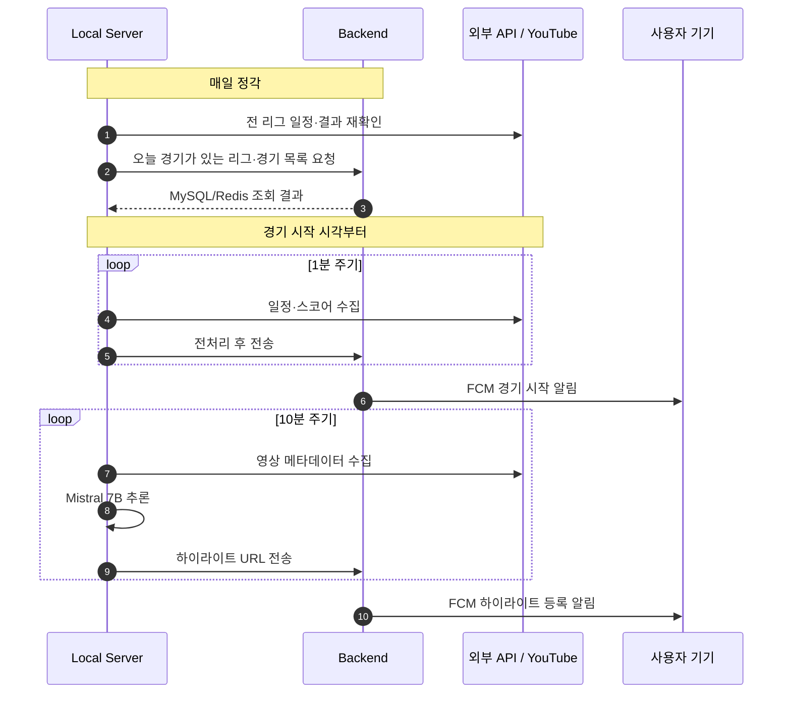

전체 리그를 상시 폴링하지 않고, **그날 경기가 있는 리그만 경기 시작 시각에 맞춰 수집**해 API 호출량과 GPU 사용을 줄였습니다.

### 3-3. 백엔드 3계층 구조

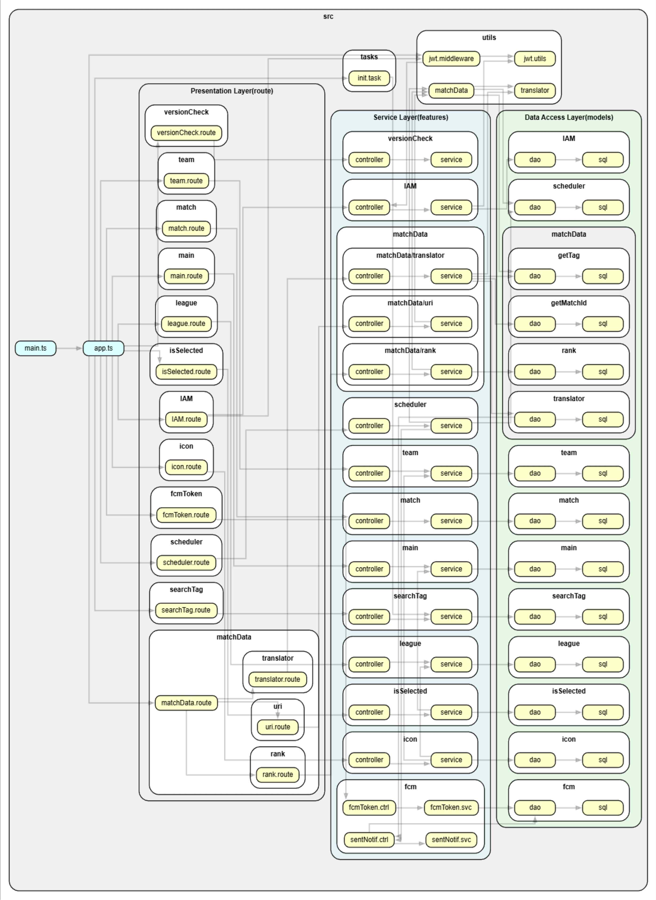

**Presentation(route) → Service(controller/service) → Data Access(dao/sql)** 로 도메인별 수직 분리했습니다.

| 모듈 | 역할 |
|---|---|
| `team` · `league` · `match` · `main` | 앱의 각 화면에 대응하는 API |
| `isSelected` | 선호 팀·리그·경기 선택 처리 |
| `IAM` · `fcmToken` | 사용자 관리, 푸시 토큰 관리 |
| `scheduler` | 로컬 서버와 일정 데이터 송수신 |
| `matchData/rank` · `uri` · `translator` | 순위, 영상 URL, AI 추론 결과 처리 |
| `searchTag` · `icon` · `versionCheck` | 검색 태그, 아이콘 교체, 앱 강제 업데이트 체크 |
| `utils` · `tasks` | JWT 미들웨어 등 공통 함수, 서버 초기화 작업 |

### 3-4. 인증

```text
[App] Google/Apple Auth → ID Token
   → [Backend] ID Token 검증 → 사용자 식별 → DB 대조
   → Access / Refresh JWT 발급 (헤더) → [App] 로컬 저장
```

- 소셜 로그인(Google, Apple)만 지원해 비밀번호를 서버에 저장하지 않음
- 계정 삭제 시 Apple 정책에 따라 사용자의 **모든 데이터를 DB에서 완전 삭제**

---

## 4. 데이터베이스 설계

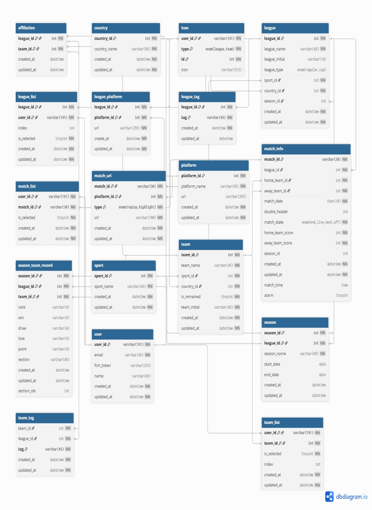

**18개 테이블**, 핵심 엔티티는 `team` · `league` · `user`.

| 설계 포인트 | 결정 | 이유 |
|---|---|---|
| 팀·리그 PK | 외부 API의 ID를 그대로 사용 | 수집 데이터와 내부 데이터 간 ID 변환 비용 제거 |
| 경기 PK | `날짜-홈팀ID-원정팀ID-더블헤더` 문자열 | 야구 더블헤더까지 포함해 경기를 명확히 식별하는 자연키 |
| 팀↔리그 관계 | `affiliation` / `season` / `season_team_record` 분리 | "소속", "시즌 참가", "시즌 성적"은 성격과 변경 주기가 다른 정보 |
| 선호 항목 해제 | 행 삭제 대신 `is_selected = false` | 선택·해제가 빈번해 삭제/생성 오버헤드를 줄임 |
| 선호 순서 | `team_list` · `league_list`에 `index` 컬럼 | 메인 화면 노출 순서를 사용자가 결정 |
| 리그 구분 | `league_type` = regular / cup | 국가별 정규 리그와 다국가 컵 대회 구분 |
| 아이콘 | 팀·리그 공용 `icon` 테이블, 이미지는 기기에 저장 | 성격이 같아 하나로 운영, 서버엔 경로만 보관 |

---

## 5. 주요 화면

### 온보딩 · 로그인

<p>
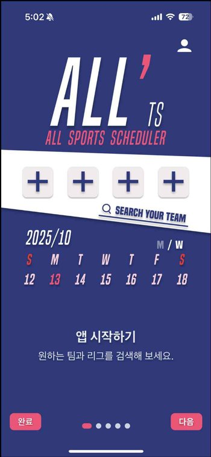
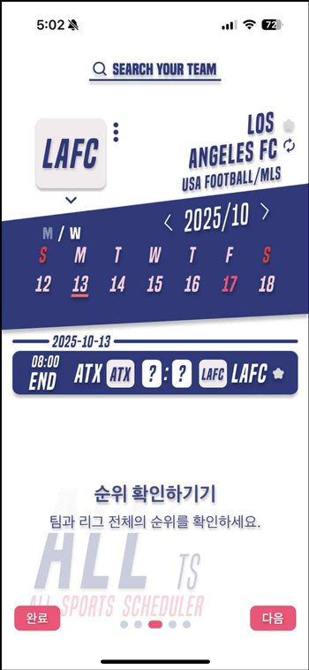
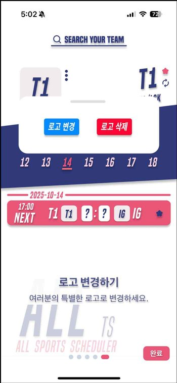
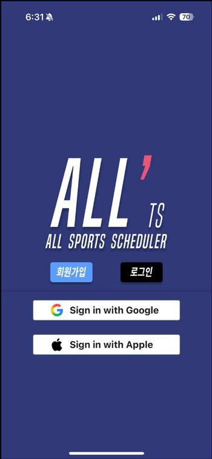
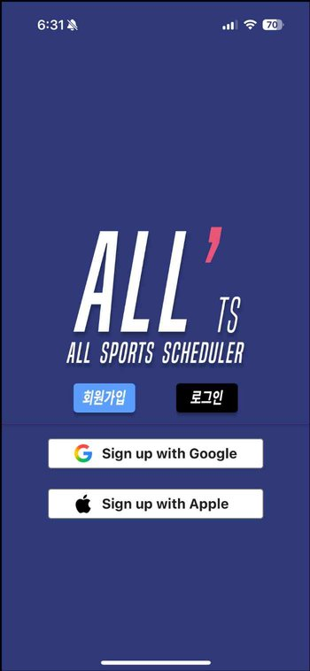
</p>

첫 실행 시에만 기능 소개 슬라이드를 노출하고(완료 여부는 로컬 스토리지에 저장), Google/Apple 계정으로 가입합니다.

### 메인 · 검색

<p>
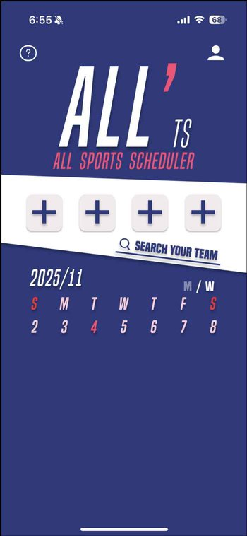
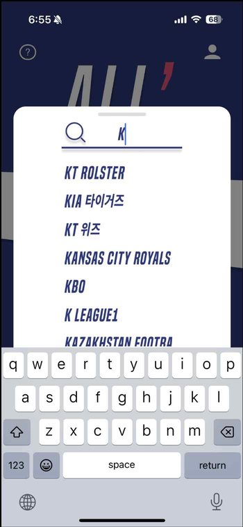

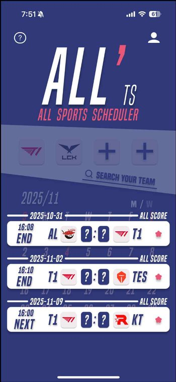
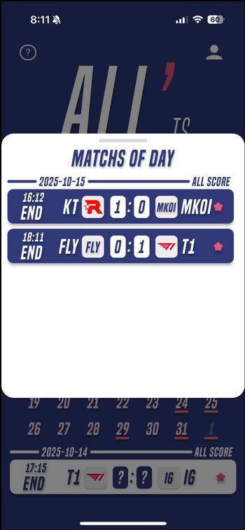
</p>

`+` 버튼으로 팀·리그를 검색해 추가합니다. 달력은 **월/주간(M/W)** 전환이 가능하고, 날짜를 누르면 그날 경기와 전체 스코어(ALL SCORE)를 볼 수 있습니다.

### 팀 · 리그 · 경기

<p>
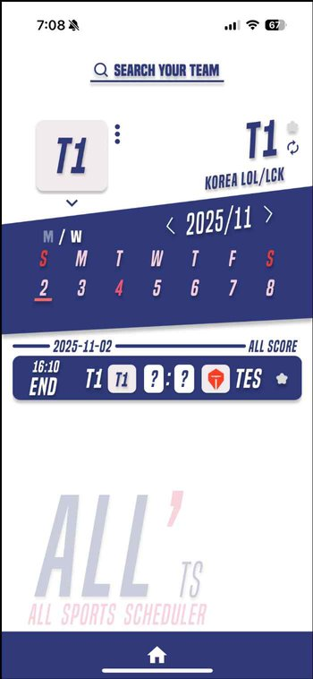

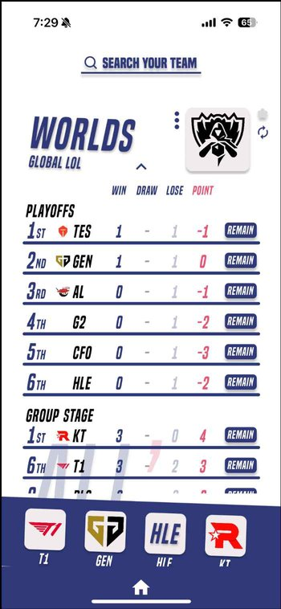
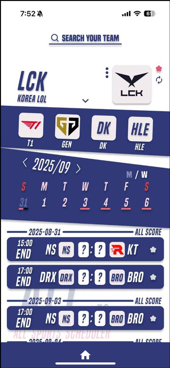

</p>

- **팀**: 순위·승패·승점, 경기 일정(END / LIVE / NEXT), 스케줄링 여부
- **리그**: 소속 팀 목록, 리그 전체 순위(플레이오프·그룹 스테이지 등 섹션 구분)
- **경기**: 스코어, 상태, 다시보기(OTT)·하이라이트(YouTube) 바로가기

### 아이콘 커스터마이징 · 푸시 알림

<p>
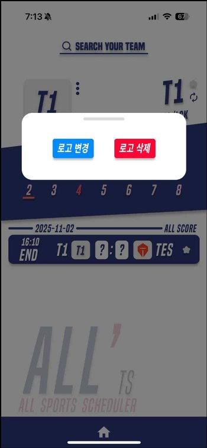
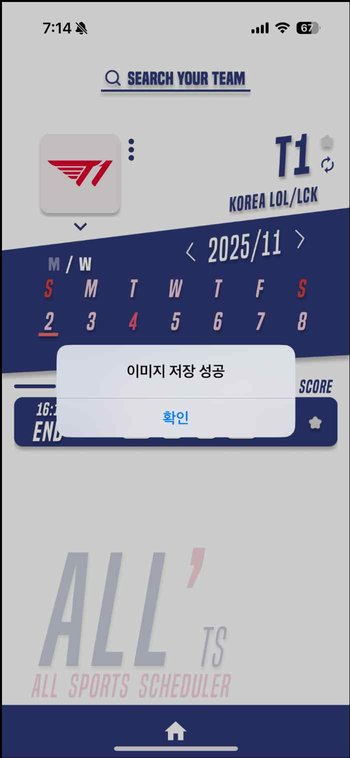
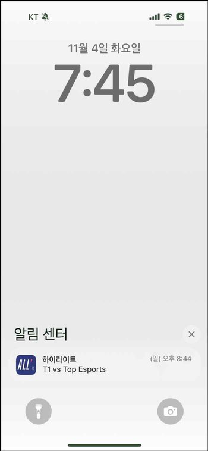
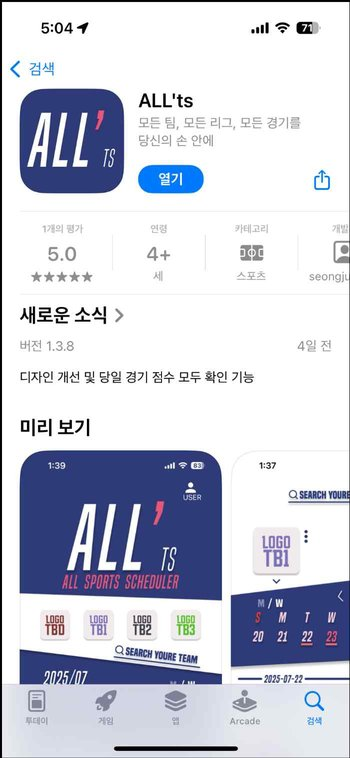
</p>

---

## 6. 트러블슈팅 & 설계 결정

### 🧩 App Store 심사: 팀·리그 로고 사용 문제

- **상황**: 초기 버전은 팀·리그 로고 이미지를 DB에 저장해 그대로 제공했으나, 비상업 앱이라도 로고를 그대로 쓰는 것은 **Apple 정책 위반**이라는 안내를 받음
- **대응**: 사용자가 원하는 이미지를 직접 지정하는 **아이콘 커스터마이징** 기능으로 전환. 이미지는 사용자 기기에 저장하고 DB에는 경로만 보관
- **다음 단계**: 외부 API의 로고를 DB에 저장하지 않고 **기기에 캐싱만** 하는 방식으로 개선 예정. API 약관상 광고·브랜딩·재배포는 금지되지만 정보 제공 목적의 사용은 허용 범위임을 확인

### 🧩 리그를 즐겨찾기하면 모든 경기를 스케줄링할까?

- 팀을 선택하면 해당 팀의 모든 경기가 메인 달력에 추가되지만, **리그 선택은 경기 일정을 추가하지 않도록** 설계
- 리그 전체 경기를 달력에 넣는 것은 이 앱이 해결하려던 **정보 과잉 문제를 다시 만드는 것**이라고 판단

### 🧩 잦은 선호 토글과 DB 부하

- 선호 팀·리그·경기는 켜고 끄는 일이 잦음 → 삭제/재생성 대신 `is_selected` 플래그로 처리해 쓰기 비용 절감

---

## 7. 한계와 향후 계획

- [ ] Google Play 출시 (React Native 기반으로 Android 지원을 목표로 개발 중)
- [ ] 외부 API 로고의 기기 캐싱 방식 적용
- [ ] 로컬 GPU 서버 의존성 완화 (현재 데이터 수집·추론이 개인 데스크탑에서 실행)
- [ ] 사용자 확보 전략 수립

---

<div align="center">

**김성준** · 한국외국어대학교 철학과 · 컴퓨터공학부

</div>
